# Plinth ERP - Entity Relationship Diagram (ERD)

This document contains the visual schema design for the Plinth ERP database using Mermaid notation, covering Core / Module 0 and Module 1 (Master Data Management).

```mermaid
erDiagram
    users {
        string id PK
        string email UK
        string name
        string password
        enum role "admin | manager | employee"
        datetime createdAt
        datetime updatedAt
    }

    audit_logs {
        string id PK
        string userId FK
        string action
        string resource
        string resourceId
        json before
        json after
        string requestId
        string ipAddress
        datetime createdAt
    }

    health_check_logs {
        string id PK
        string status
        int latencyMs
        datetime timestamp
    }

    categories {
        string id PK
        string code UK
        string name
        string description
        string parentId FK
        enum status "LifecycleStatus"
        datetime deactivatedAt
        string supersededById FK
        datetime createdAt
        datetime updatedAt
    }

    product_families {
        string id PK
        string code UK
        string name
        string description
        string categoryId FK
        enum status "LifecycleStatus"
        datetime deactivatedAt
        string supersededById FK
        datetime createdAt
        datetime updatedAt
    }

    products {
        string id PK
        string sku UK
        string name
        string description
        string productFamilyId FK
        string categoryId FK
        string uomId FK
        enum status "LifecycleStatus"
        int version
        datetime effectiveDate
        json metadata
        datetime deactivatedAt
        string supersededById FK
        datetime createdAt
        datetime updatedAt
    }

    product_variants {
        string id PK
        string productId FK
        string sku UK
        string name
        string color
        string size
        json specifications
        enum status "LifecycleStatus"
        int version
        datetime deactivatedAt
        string supersededById FK
        datetime createdAt
        datetime updatedAt
    }

    materials {
        string id PK
        string code UK
        string name
        string description
        enum materialType "RAW_MATERIAL | HARDWARE | PACKAGING | COMPONENT"
        string categoryId FK
        string uomId FK
        json specs
        enum status "LifecycleStatus"
        int version
        datetime effectiveDate
        datetime deactivatedAt
        string supersededById FK
        datetime createdAt
        datetime updatedAt
    }

    units_of_measure {
        string id PK
        string code UK
        string name
        string symbol
        string dimension
        enum status "LifecycleStatus"
        datetime deactivatedAt
        datetime createdAt
        datetime updatedAt
    }

    uom_conversions {
        string id PK
        string fromUomId FK
        string toUomId FK
        decimal factor
        datetime effectiveDate
        int version
        enum status "LifecycleStatus"
        datetime deactivatedAt
        string supersededById FK
        datetime createdAt
        datetime updatedAt
    }

    pack_sizes {
        string id PK
        string materialId FK
        decimal packQty
        string uomId FK
        datetime effectiveDate
        int version
        enum status "LifecycleStatus"
        datetime deactivatedAt
        string supersededById FK
        datetime createdAt
        datetime updatedAt
    }

    vendors {
        string id PK
        string code UK
        string name
        string contactEmail
        string contactPhone
        string taxNumber
        json address
        string currency
        string paymentTerms
        enum status "LifecycleStatus"
        datetime deactivatedAt
        string supersededById FK
        datetime createdAt
        datetime updatedAt
    }

    customers {
        string id PK
        string code UK
        string name
        string contactEmail
        string contactPhone
        string taxNumber
        json billingAddress
        json shippingAddress
        string currency
        decimal creditLimit
        enum status "LifecycleStatus"
        datetime deactivatedAt
        string supersededById FK
        datetime createdAt
        datetime updatedAt
    }

    employees {
        string id PK
        string employeeCode UK
        string firstName
        string lastName
        string email UK
        string phone
        string role
        string departmentId FK
        enum status "LifecycleStatus"
        datetime deactivatedAt
        datetime createdAt
        datetime updatedAt
    }

    sales_channels {
        string id PK
        string code UK
        string name
        string description
        string currency
        enum status "LifecycleStatus"
        datetime deactivatedAt
        datetime createdAt
        datetime updatedAt
    }

    factories {
        string id PK
        string code UK
        string name
        json address
        enum status "LifecycleStatus"
        datetime deactivatedAt
        datetime createdAt
        datetime updatedAt
    }

    departments {
        string id PK
        string code UK
        string name
        string factoryId FK
        enum status "LifecycleStatus"
        datetime deactivatedAt
        datetime createdAt
        datetime updatedAt
    }

    work_centers {
        string id PK
        string code UK
        string name
        string departmentId FK
        decimal capacityPerHour
        enum status "LifecycleStatus"
        datetime deactivatedAt
        datetime createdAt
        datetime updatedAt
    }

    warehouse_locations {
        string id PK
        string code UK
        string name
        string factoryId FK
        string type
        enum status "LifecycleStatus"
        datetime deactivatedAt
        datetime createdAt
        datetime updatedAt
    }

    qc_rules {
        string id PK
        string code UK
        string name
        string description
        string targetType
        string targetId
        json parameters
        int version
        datetime effectiveFrom
        datetime effectiveTo
        enum status "LifecycleStatus"
        datetime deactivatedAt
        string supersededById FK
        datetime createdAt
        datetime updatedAt
    }

    wastage_rules {
        string id PK
        string code UK
        string name
        string materialId FK
        string workCenterId FK
        decimal standardWastagePct
        decimal tolerancePct
        int version
        datetime effectiveFrom
        datetime effectiveTo
        enum status "LifecycleStatus"
        datetime deactivatedAt
        string supersededById FK
        datetime createdAt
        datetime updatedAt
    }

    product_routes {
        string id PK
        string code UK
        string name
        string productId FK
        string productVariantId FK
        int version
        datetime effectiveFrom
        datetime effectiveTo
        enum status "LifecycleStatus"
        datetime deactivatedAt
        string supersededById FK
        datetime createdAt
        datetime updatedAt
    }

    route_steps {
        string id PK
        string routeId FK
        int sequenceNumber
        string stepName
        string workCenterId FK
        string departmentId FK
        int standardDurationMinutes
        boolean isQcRequired
        string qcRuleId FK
        enum status "LifecycleStatus"
        datetime createdAt
        datetime updatedAt
    }

    master_data_import_batches {
        string id PK
        string batchNumber UK
        string entityType
        int totalRows
        int validRows
        int invalidRows
        int committedRows
        enum status "ImportBatchStatus"
        string importedBy
        json metadata
        datetime createdAt
        datetime updatedAt
    }

    master_data_import_rows {
        string id PK
        string batchId FK
        int rowNumber
        json rawData
        json normalizedData
        enum status "ImportRowStatus"
        json errors
        string duplicateMatchId
        string resolutionDecision
        datetime createdAt
        datetime updatedAt
    }

    users ||--o{ audit_logs : "creates"
    categories ||--o{ categories : "parent_to_child"
    categories ||--o{ product_families : "contains"
    categories ||--o{ products : "categorizes"
    categories ||--o{ materials : "categorizes"
    product_families ||--o{ products : "groups"
    products ||--o{ product_variants : "has_variants"
    products ||--o{ product_routes : "has_routes"
    product_variants ||--o{ product_routes : "has_variant_routes"
    units_of_measure ||--o{ products : "primary_uom"
    units_of_measure ||--o{ materials : "primary_uom"
    units_of_measure ||--o{ uom_conversions : "from_uom"
    units_of_measure ||--o{ uom_conversions : "to_uom"
    units_of_measure ||--o{ pack_sizes : "pack_uom"
    materials ||--o{ pack_sizes : "has_pack_sizes"
    materials ||--o{ wastage_rules : "applies_wastage"
    factories ||--o{ departments : "houses"
    factories ||--o{ warehouse_locations : "contains"
    departments ||--o{ work_centers : "operates"
    departments ||--o{ employees : "employs"
    departments ||--o{ route_steps : "executes"
    work_centers ||--o{ route_steps : "hosts"
    work_centers ||--o{ wastage_rules : "applies_wastage"
    qc_rules ||--o{ route_steps : "inspects"
    product_routes ||--o{ route_steps : "contains_steps"
    master_data_import_batches ||--o{ master_data_import_rows : "contains_rows"
```

## Description of Module 1 Master Data Entities

### 1. 6-State Lifecycle Model (`LifecycleStatus`)
Every master entity has an explicit lifecycle state:
- `DRAFT`: Newly created or imported entity. Incomplete or pending initial review. Cannot be used in operational workflows.
- `PENDING_VALIDATION`: Submitted for formal review. Awaiting authorized approval.
- `APPROVED`: Formally reviewed and validated. Immutable identity.
- `ACTIVE`: Approved and currently live/referenceable by operational modules (procurement, inventory, BOM, production).
- `INACTIVE`: Soft-deactivated entity (`deactivatedAt` set). Cannot be selected for new transactions.
- `SUPERSEDED`: Replaced by a newer version or revised master record (`supersededById` points to the successor).

### 2. Product Hierarchy & Variants
- **`Category`**: Hierarchical classification for finished goods, raw materials, and components.
- **`ProductFamily`**: Grouping of related products sharing core attributes and manufacturing lines.
- **`Product`**: Master finished good or sellable assembly with a globally unique SKU and base UOM.
- **`ProductVariant`**: Color, size, or spec-differentiated variant carrying an individual SKU.

### 3. Materials, Components & Packaging
- **`Material`**: Master record for raw materials, hardware, consumables, packaging, and components. Carries flexible structured specifications (`specs` JSON) for dimensions, grade, density, etc.

### 4. Units of Measure, Conversions & Pack Sizes
- **`UnitOfMeasure`**: Canonical units (e.g. `KG`, `MTR`, `PCS`, `BOX`).
- **`UomConversion`**: Versioned conversion factor between pairs of UOMs with effective dates. Circular conversion chains are rejected by the service layer.
- **`PackSize`**: Material packaging multipliers (e.g., 50 kg bag, 1000 pcs box).

### 5. Organizational Structure & Routing
- **`Factory`**, **`Department`**, **`WorkCenter`**, **`WarehouseLocation`**: Physical and operational taxonomy.
- **`QcRule`**, **`WastageRule`**: Versioned parameters for quality tolerances and process wastage.
- **`ProductRoute`**, **`RouteStep`**: Ordered manufacturing sequence linked to departments, work centers, and QC rules.

### 6. Staged Import Subsystem
- **`MasterDataImportBatch`** & **`MasterDataImportRow`**: Two-phase import pattern preventing raw CSV/XLSX imports from polluting live data. Rows are staged, normalized, validated, and reviewed for duplicates prior to committing as `DRAFT` / `PENDING_VALIDATION`.
